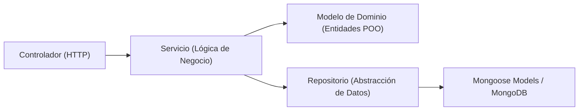

# AGENTS.md - Contexto, Arquitectura y Decisiones del Sistema
## Proyecto: Three Masters Spa (Spa de Uñas)
**Asignatura:** Ingeniería de Software Orientada a Objetos (6° Semestre - USCO)  
**Propósito:** Este documento define la arquitectura, lineamientos de diseño, decisiones formales de requerimientos (ADRs) y trazabilidad para guiar a cualquier agente o desarrollador que trabaje en el proyecto.

---

## 1. Visión General del Proyecto y Stack Tecnológico

Three Masters Spa es una solución de software orientada a la gestión y agendamiento de citas, catálogo de servicios, control de profesionales y administración de un salón de belleza y spa de uñas.

* **Backend (`backend-spa-three-masters/`):**
  - **Runtime & Entorno:** Node.js (ES Modules `"type": "module"`).
  - **Framework:** Express 5.3 (`app.js`, `app.routes.js`).
  - **Base de Datos & ORM/ODM:** MongoDB con Mongoose 9.
  - **Autenticación & Criptografía:** JWT (`jsonwebtoken`) con expiración configurable, `bcryptjs` para hashing de contraseñas (10 rondas), `crypto` para tokens opacos SHA-256 de citas públicas.
  - **Pruebas:** `node --test` (runner nativo de Node.js).

* **Frontend (`frontend-spa-three-masters/`):**
  - **Librería & Herramientas:** React 19, Vite 8, React Router v7.
  - **Estilos:** CSS Modules y variables CSS temáticas.
  - **Cliente HTTP:** Axios con instancia personalizada (`axiosClient.js`) e interceptores para inyección de token JWT y detección de expiración (401).

---

## 2. Arquitectura de Software y Principios POO

El sistema aplica estrictamente principios de **Ingeniería de Software Orientada a Objetos (ISOO)** y patrones de diseño reconocidos:

1. **Inyección de Dependencias (Manual):**
   - Configurada centralizadamente en `backend-spa-three-masters/src/app.routes.js`.
   - Los repositorios se instancian primero y se inyectan en los servicios; los servicios se inyectan en los controladores.
2. **Patrón Modelo de Dominio (*Domain Model*):**
   - La lógica pura de negocio reside en clases de dominio POO independientes de la base de datos (ej. `src/modules/citas/models/domain/Cita.js`, `Servicio.js`, `Cliente.js`, `Hora.js`, `Fecha.js`).
   - Mongoose integra estas clases mediante `schema.loadClass(EntidadDominio)`.
3. **Patrón Repositorio (*Repository Pattern*):**
   - Aísla las consultas de Mongoose del resto de la aplicación (ej. `CitaRepositorio`, `ServicioRepositorio`, etc.).
4. **Manejo Centralizado de Errores Operacionales:**
   - Jerarquía basada en `AppError` (`src/shared/errors/AppError.js`):
     - `ValidationError` (400)
     - `UnauthorizedError` (401)
     - `ForbiddenError` (403)
     - `NotFoundError` (404)
     - `ConflictError` (409)
   - Capturados de forma global por `src/shared/middlewares/error.middleware.js`.

---

## 3. Decisiones de Requerimientos y Diseño (ADRs)

> [!IMPORTANT]
> Estas decisiones han sido aprobadas y constituyen la línea base del proyecto. Cualquier agente posterior **debe respetarlas y no proponer alternativas descartadas**.

### ADR-01: Canal y Flujos de Notificaciones
* **Decisión:** El canal de comunicación con el cliente es **exclusivamente WhatsApp**. Se descarta el envío de correos electrónicos (Nodemailer/SMTP) o SMS para evitar sobrecostos y fricción con los usuarios.
* **Estrategia de entrega vigente (fase actual):** notificaciones **asistidas por enlaces `wa.me`** con el mensaje ya redactado desde el panel. No se integra todavía la API oficial de WhatsApp Business (requiere número dedicado, verificación y aprobación de plantillas, con latencias de 24–72 h y posible cobro), por riesgo frente a la fecha de entrega.
  - Los mensajes **no dependen del enlace único con token**: incluyen servicio, profesional, fecha, hora y motivo, de modo que la clienta lee todo en el chat.
  - El adaptador de envío vive en el frontend ([`utils/reserva.js`](file:///c:/Users/ASUS/Documents/USCO/6%20SEMESTRE/Ingenieria%20de%20Sotfware%20Orientada%20a%20Objetos/Proyecto%20Final/spa-uñas/frontend-spa-three-masters/src/utils/reserva.js)): `enlaceWhatsApp`, `mensajeEnlaceCita` y `mensajeCitaCancelada`. Cuando se automatice, solo se reemplaza esa capa.
* **Flujos Requeridos:**
  1. **Agendamiento de Cita (Público / Registrado):**
     - *Cliente:* Recibe confirmación vía WhatsApp con los detalles de su cita y su enlace único con token personal (`/cita/:token`).
     - *Profesional:* Se le notifica vía WhatsApp / enlace directo cuando una nueva cita queda confirmada en su agenda.
  2. **Cancelación de Cita (por Administrador o Profesional):**
     - Se notifica al cliente a su número de WhatsApp registrado, informando que su cita fue cancelada y especificando el **motivo obligatorio** de cancelación.
     - Implementado: tras cancelar en `CancelarCitaFormulario.jsx` el diálogo **no se cierra** y muestra el botón **“Avisar por WhatsApp”** con el mensaje prellenado.
  3. **Cancelación de Cita (por Cliente o Profesional):**
     - Se notifica de inmediato al Administrador para permitir la liberación y reprogramación de la agenda del salón.
  4. **Baja definitiva de una profesional con citas futuras:**
     - Si el administrador confirma cancelarlas, al terminar la baja se listan **botones de WhatsApp por clienta** en `EliminarProfesionalFormulario.jsx`, cada uno con fecha, servicio y motivo.

### ADR-02: Estrategia de Pruebas de Software (Requisito Docente USCO)
* **Requisito del Docente:** Se debe evidenciar formalmente la verificación y validación del sistema mediante pruebas estáticas y, como mínimo, **pruebas unitarias dinámicas**.
* **Decisión de Implementación:**
  1. **Pruebas Estáticas:** Linters (`oxlint` en frontend y verificación de formato).
  2. **Pruebas Unitarias Backend:** Implementadas con el runner nativo de Node.js (`node --test`), sin dependencias pesadas adicionales.
  3. **Alcance de Pruebas Obligatorio:**
     - `Cita.js`: Validación de solapamiento (`seSolapaCon`), coherencia de horarios inicio/fin (`validarHorario`), transiciones válidas e inválidas de estado (`cancelar` con/sin motivo según rol, `reprogramar`, `completar`, `marcarNoAsistida`).
     - `Hora.js` y `Fecha.js`: Normalización UTC, clave YYYY-MM-DD, conversión a minutos, adición de duración y detección de fin de día.
     - `CitaServicio.js`: Cálculo de slots de disponibilidad (`obtenerDisponibilidad`) con mocks de repositorios de horarios y citas previas.
     - `ProfesionalServicio.js`: Guardas de la baja definitiva (bloqueos 409 por citas u horarios, motivo obligatorio, borrado de cuenta) con dobles de repositorios y reloj fijo.

### ADR-03: Baja definitiva de profesionales y preservación del historial
* **Decisión:** dar de baja a una profesional es un flujo explícito con guardas, no un `DELETE` directo.
* **Reglas implementadas en `ProfesionalServicio.eliminarProfesional`:**
  1. Si hay **citas confirmadas futuras**, la baja se bloquea con 409 salvo que se envíe `cancelarCitas: true` y un `motivo` de mínimo 3 caracteres. En ese caso las citas se conservan como `cancelada`, con `canceladaPor: administrador`, `motivoCancelacion` y `fechaCancelacion`.
  2. Si hay **horarios**, se eliminan solo con `eliminarHorarios: true`; de lo contrario se bloquea con 409.
  3. La **cuenta de acceso** solo se borra con `eliminarCuenta: true` y siempre que su rol sea `profesional`. Las cuentas de otro rol o inexistentes no rompen la baja.
  4. Todas las validaciones ocurren antes de borrar cualquier documento.
* **Historial:** `Cita` guarda un snapshot `profesional.nombre` al momento de agendar (mismo patrón que `servicio.name/price`). Si el perfil se elimina, el nombre sigue visible en el panel, en el historial de la clienta y en el enlace público.
* **Backfill obligatorio antes de la primera baja:** `npm run backfill:profesional-citas` (acepta `--dry-run`) rellena el snapshot en citas antiguas. Sin él, las citas previas a este cambio perderían el nombre al eliminar el perfil.
* **Frontend:** `EliminarProfesionalFormulario.jsx` muestra el resumen de citas/horarios, permite escribir el motivo, elegir **Conservar cuenta** o **Eliminar cuenta**, y al finalizar lista los botones de WhatsApp por clienta.

### ADR-04: Analíticas, Métricas y Descarte de Reportes Externos
* **Decisión:** **NO se generarán reportes exportables a PDF ni a Excel/CSV.**
* **Alcance Aprobado:**
  - El sistema mantendrá un **módulo analítico integrado en la UI** del Administrador (`ResumenAdminPage.jsx`):
    - Tarjetas de KPIs (citas de hoy, citas activas, canceladas, completadas y no asistió).
    - Estimaciones monetarias e ingresos recaudados y proyectados.
    - Filtros temporales dinámicos por **Semana**, **Mes** y **Año**.
    - Nivel de ocupación y distribución de carga por profesional.

---

## 4. Estructura de Roles y Accesos

| Rol | Alcance y Vistas | Permisos Clave |
| :--- | :--- | :--- |
| **Público / Invitado** | `/`, `/reservar`, `/cita/:token`, `/cuenta` | Consulta catálogo, revisa disponibilidad en tiempo real, reserva sin cuenta, gestiona o cancela su cita por token seguro. |
| **Cliente** | `/cuenta/perfil`, `/cuenta/citas/:id` | Gestiona su perfil (nombre, teléfono, correo), historial de citas propias y cancelación directa autenticada. |
| **Profesional** | `/profesional/agenda` | Consulta su agenda del día y fechas futuras, visualiza clientas y servicios asignados, cancela citas justificando motivo. |
| **Administrador** | `/admin/*` (`resumen`, `citas`, `servicios`, `categorias`, `profesionales`, `horarios`) | Control total, CRUD de catálogos y personal, reprogramación de citas, estadísticas con filtros temporales. |

---

## 5. Trazabilidad y Pendientes Técnicos (Backlog de Cierre)

Estado de las prioridades técnicas de cierre:

1. **Pruebas Unitarias & Conexión Total del Modelo de Dominio (Backend):** ✅ **COMPLETADO**
   - Suite formal de 9 archivos implementada con `node --test` y `node:assert/strict`:
     - [`Hora.test.js`](file:///c:/Users/ASUS/Documents/USCO/6%20SEMESTRE/Ingenieria%20de%20Sotfware%20Orientada%20a%20Objetos/Proyecto%20Final/spa-uñas/backend-spa-three-masters/test/Hora.test.js): validación, conversión y aritmética de horas.
     - [`Fecha.test.js`](file:///c:/Users/ASUS/Documents/USCO/6%20SEMESTRE/Ingenieria%20de%20Sotfware%20Orientada%20a%20Objetos/Proyecto%20Final/spa-uñas/backend-spa-three-masters/test/Fecha.test.js): normalización UTC y claves.
     - [`Cita.test.js`](file:///c:/Users/ASUS/Documents/USCO/6%20SEMESTRE/Ingenieria%20de%20Sotfware%20Orientada%20a%20Objetos/Proyecto%20Final/spa-uñas/backend-spa-three-masters/test/Cita.test.js): solapamientos, reglas de negocio de cancelación y transiciones de estado.
     - [`Cliente.test.js`](file:///c:/Users/ASUS/Documents/USCO/6%20SEMESTRE/Ingenieria%20de%20Sotfware%20Orientada%20a%20Objetos/Proyecto%20Final/spa-uñas/backend-spa-three-masters/test/Cliente.test.js): sanitización y vinculación de cuenta.
     - [`Horario.test.js`](file:///c:/Users/ASUS/Documents/USCO/6%20SEMESTRE/Ingenieria%20de%20Sotfware%20Orientada%20a%20Objetos/Proyecto%20Final/spa-uñas/backend-spa-three-masters/test/Horario.test.js): cobertura de turnos y solapamiento laboral.
     - [`Servicio.test.js`](file:///c:/Users/ASUS/Documents/USCO/6%20SEMESTRE/Ingenieria%20de%20Sotfware%20Orientada%20a%20Objetos/Proyecto%20Final/spa-uñas/backend-spa-three-masters/test/Servicio.test.js): cálculo de hora fin, validación de precio y activación/desactivación.
     - [`Categoria.test.js`](file:///c:/Users/ASUS/Documents/USCO/6%20SEMESTRE/Ingenieria%20de%20Sotfware%20Orientada%20a%20Objetos/Proyecto%20Final/spa-uñas/backend-spa-three-masters/test/Categoria.test.js): transiciones de estado activo/inactivo.
     - [`Profesional.test.js`](file:///c:/Users/ASUS/Documents/USCO/6%20SEMESTRE/Ingenieria%20de%20Sotfware%20Orientada%20a%20Objetos/Proyecto%20Final/spa-uñas/backend-spa-three-masters/test/Profesional.test.js): validación de atención según especialidad (`atiende`), agregación y remoción.
     - [`ProfesionalServicio.test.js`](file:///c:/Users/ASUS/Documents/USCO/6%20SEMESTRE/Ingenieria%20de%20Sotfware%20Orientada%20a%20Objetos/Proyecto%20Final/spa-uñas/backend-spa-three-masters/test/ProfesionalServicio.test.js): guards de la baja definitiva (citas futuras, horarios, motivo y cuenta) con reloj fijo.
   - Además, [`tests/citas.test.js`](file:///c:/Users/ASUS/Documents/USCO/6%20SEMESTRE/Ingenieria%20de%20Sotfware%20Orientada%20a%20Objetos/Proyecto%20Final/spa-uñas/backend-spa-three-masters/tests/citas.test.js) cubre el flujo de `CitaServicio.crearCita`, incluido el snapshot `profesional.nombre`.
   - Conexión activa en capas de servicio:
     - `cita.servicio.js`: usa `Horario.duracionMinutos` y `Horario.cubre` en cálculo de slots de disponibilidad.
     - `horario.servicio.js`: valida rangos con `Hora` y previene solapamientos con `Horario.seSolapaCon`.
     - `servicio.servicio.js`: valida precios con `Servicio.cambiarPrecio` y estados con `activar`/`desactivar`.
     - `categoria.servicio.js`: gestiona transiciones con `Categoria.activar`/`desactivar`.

2. **Filtros Temporales en Dashboard Admin:** ✅ **COMPLETADO**
   - Implementado en [`ResumenAdminPage.jsx`](file:///c:/Users/ASUS/Documents/USCO/6%20SEMESTRE/Ingenieria%20de%20Sotfware%20Orientada%20a%20Objetos/Proyecto%20Final/spa-uñas/frontend-spa-three-masters/src/pages/admin/ResumenAdminPage.jsx) y [`ResumenAdmin.module.css`](file:///c:/Users/ASUS/Documents/USCO/6%20SEMESTRE/Ingenieria%20de%20Sotfware%20Orientada%20a%20Objetos/Proyecto%20Final/spa-uñas/frontend-spa-three-masters/src/pages/admin/ResumenAdmin.module.css).
   - Selector reactivo segmentado: **Esta semana**, **Este mes**, **Este año** e **Histórico**.
   - Recalcula dinámicamente: KPIs superiores (citas del período, confirmadas, completadas, ingresos recaudados), distribución porcentual por estado y ranking de servicios más solicitados.

3. **Notificaciones WhatsApp (Parcial: entrega por enlaces `wa.me`):** 🟡 **EN CURSO**
   - ✅ Aviso de cancelación con motivo a la clienta (botón “Avisar por WhatsApp” tras cancelar).
   - ✅ Aviso a cada clienta afectada al dar de baja a una profesional.
   - ⬜ Aviso de nueva cita a la profesional al agendar.
   - ⬜ Aviso de cancelación al administrador cuando cancela la clienta.
   - ⬜ Automatización vía API oficial de WhatsApp Business (fuera de esta fase; ver ADR-01).

4. **Calendario Interactivo en el Panel de Citas:** ✅ **COMPLETADO**
   - Implementado en [`CalendarioFiltroCitas.jsx`](file:///c:/Users/ASUS/Documents/USCO/6%20SEMESTRE/Ingenieria%20de%20Sotfware%20Orientada%20a%20Objetos/Proyecto%20Final/spa-uñas/frontend-spa-three-masters/src/components/admin/CalendarioFiltroCitas.jsx).
   - Conserva el lenguaje visual del calendario de agendamiento público (días circulares, navegación mensual y acento vino) adaptado a los tokens del panel.
   - Se ubica a la izquierda del panel de citas; al elegir un día actúa como filtro (conmutador) y la tabla muestra ese día en orden cronológico. Sin selección se listan todas las citas, también en orden cronológico.
   - Marca con un punto los días con citas, muestra el total del mes y ofrece atajos **Hoy** y **Ver toda la agenda**. Convive con el buscador y los filtros de estado y fecha existentes.

5. **Subida de Imágenes del Catálogo y del Equipo:** ✅ **COMPLETADO**
   - Backend: módulo `src/modules/uploads/` con `multer` (memoria, máx. 5 MB, solo JPG/PNG/WEBP/AVIF) y `cloudinary` como almacenamiento persistente; ruta `POST /api/uploads` protegida con `guardia.soloAdministrador`. Devuelve `{ url }` y exige `carpeta` (`servicios` | `profesionales`).
   - Frontend: [`uploadService.js`](file:///c:/Users/ASUS/Documents/USCO/6%20SEMESTRE/Ingenieria%20de%20Sotfware%20Orientada%20a%20Objetos/Proyecto%20Final/spa-uñas/frontend-spa-three-masters/src/api/uploadService.js) y [`CampoImagen.jsx`](file:///c:/Users/ASUS/Documents/USCO/6%20SEMESTRE/Ingenieria%20de%20Sotfware%20Orientada%20a%20Objetos/Proyecto%20Final/spa-uñas/frontend-spa-three-masters/src/components/admin/CampoImagen.jsx) con arrastrar-y-soltar, vista previa, progreso y validación en cliente.
   - Reemplaza los campos de URL en `ServicioFormulario.jsx` y `ProfesionalFormulario.jsx`; `urlFoto` sigue siendo un `String`, por lo que el catálogo, el equipo y las tablas del panel no requieren cambios.
   - Variables requeridas: `CLOUDINARY_CLOUD_NAME`, `CLOUDINARY_API_KEY`, `CLOUDINARY_API_SECRET` (documentadas en `backend-spa-three-masters/.env.example`).

6. **Baja Definitiva de Profesionales con Preservación de Historial:** ✅ **COMPLETADO**
   - Backend: `GET /api/profesionales/:id/resumen-baja` y `DELETE /api/profesionales/:id` con opciones `cancelarCitas`, `eliminarHorarios`, `eliminarCuenta` y `motivo`. Toda la lógica vive en [`profesional.servicio.js`](file:///c:/Users/ASUS/Documents/USCO/6%20SEMESTRE/Ingenieria%20de%20Sotfware%20Orientada%20a%20Objetos/Proyecto%20Final/spa-uñas/backend-spa-three-masters/src/modules/profesionales/profesional.servicio.js) y se prueba en [`ProfesionalServicio.test.js`](file:///c:/Users/ASUS/Documents/USCO/6%20SEMESTRE/Ingenieria%20de%20Sotfware%20Orientada%20a%20Objetos/Proyecto%20Final/spa-uñas/backend-spa-three-masters/test/ProfesionalServicio.test.js).
   - Snapshot `profesional.nombre` en `Cita` + fallback en [`utils/citas.js`](file:///c:/Users/ASUS/Documents/USCO/6%20SEMESTRE/Ingenieria%20de%20Sotfware%20Orientada%20a%20Objetos/Proyecto%20Final/spa-uñas/frontend-spa-three-masters/src/utils/citas.js).
   - Backfill: `npm run backfill:profesional-citas` (acepta `--dry-run`).
   - Frontend: [`EliminarProfesionalFormulario.jsx`](file:///c:/Users/ASUS/Documents/USCO/6%20SEMESTRE/Ingenieria%20de%20Sotfware%20Orientada%20a%20Objetos/Proyecto%20Final/spa-uñas/frontend-spa-three-masters/src/components/admin/EliminarProfesionalFormulario.jsx) con resumen, motivo obligatorio, elección de cuenta y avisos por WhatsApp.

