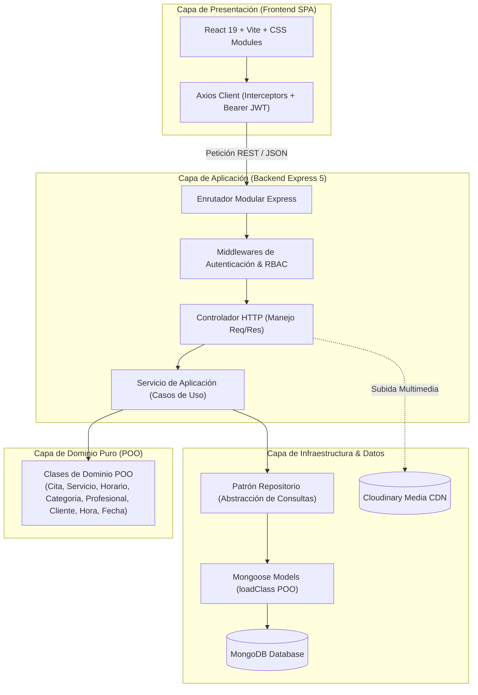

<div align="center">

#  Three Masters Spa
### Plataforma Integral de Agendamiento, Gestión de Citas y Administración para Salón de Belleza & Spa de Uñas

[](https://nodejs.org/)
[](https://expressjs.com/)
[](https://react.dev/)
[](https://vitejs.dev/)
[](https://www.mongodb.com/)
[](https://cloudinary.com/)
[](https://nodejs.org/api/test.html)

<p align="center">
  <b>Proyecto Final de Ingeniería de Software Orientada a Objetos (ISOO - 6° Semestre)</b><br>
  <i>Universidad Surcolombiana (USCO) • Facultad de Ingeniería</i>
</p>

[✨ Características](#-características-principales) •
[🏛️ Arquitectura POO](#-arquitectura-de-software-y-principios-poo) •
[🧪 Pruebas Unitarias](#-estrategia-de-pruebas-unitarias-backend) •
[🚀 Instalación Local](#-instalación-y-puesta-en-marcha) •
[🌐 Despliegue](#-arquitectura-de-despliegue-en-la-nube) •
[👥 Roles & Vistas](#-estructura-de-roles-y-permisos)

---

</div>

## 📖 Descripción del Proyecto

**Three Masters Spa** es una solución web integral diseñada para digitalizar, optimizar y automatizar el ciclo de vida completo de un centro de estética y cuidado de uñas. 

El sistema resuelve la fricción típica de reservas mediante un motor inteligente de disponibilidad en tiempo real, agendamiento sin obligatoriedad de registro previo, gestión segura de citas vía tokens criptográficos, integración de avisos vía **WhatsApp** y un panel analítico ejecutivo con métricas temporales para la toma de decisiones empresariales.

---

## ✨ Características Principales

### 👩‍🦰 Para Clientes & Invitadas
* **Agendamiento Inteligente en Tiempo Real:** Cálculo dinámico de franjas horarias libres en intervalos de 15 minutos, validando la jornada laboral de cada profesional y evitando solapamientos.
* **Reserva sin Fricción:** Posibilidad de reservar como invitada (solo nombre y WhatsApp) o como clienta registrada.
* **Autogestión por Enlace Seguro (Token SHA-256):** Cada cita confirmada genera un enlace único (`/cita/:token`) que permite consultar detalles y cancelar sin exponer identificadores internos de base de datos.
* **Historial y Perfil Personal:** Clientas registradas pueden consultar sus citas pasadas y activas, actualizar datos de contacto y gestionar sus reservas.

### 💅 Para Profesionales
* **Agenda Diaria y Futura:** Vista organizada de compromisos laborales con información detallada de clienta, servicio y duración.
* **Cancelación con Justificación Obligatoria:** Capacidad de cancelar citas asignadas exigiendo un motivo explícito para registro y posterior notificación a la clienta.

### 👑 Para la Administración
* **Dashboard Ejecutivo con Filtros Temporales:** KPIs en tiempo real (citas totales, confirmadas, completadas, ingresos recaudados) con selector reactivo: *Esta semana*, *Este mes*, *Este año* e *Histórico*.
* **Calendario Interactivo con Sincronización Bidireccional:** Visualizador mensual con indicador de días con citas; al seleccionar un día actúa como filtro y lista las citas en estricto orden cronológico.
* **Gestión Multimedia de Catálogo y Equipo:** Subida de imágenes persistentes a la nube (**Cloudinary**) mediante arrastrar y soltar con previsualización inmediata.
* **Control Total de Horarios y Catálogo:** CRUD de servicios, categorías de atención y franjas horarias semanales por profesional.
* **Canal Asistido de Notificaciones WhatsApp:** Generación instantánea de mensajes preformateados (`wa.me`) con detalles del servicio, horario y motivo de cancelación.

---

## 🏛️ Arquitectura de Software y Principios POO

El backend implementa una **Arquitectura en Capas Limpia (Layered Clean Architecture)** que prioriza los principios de la **Ingeniería de Software Orientada a Objetos (ISOO)** y desacopla la lógica de negocio de los detalles de infraestructura:



### Principios y Patrones de Diseño Aplicados

1. **Patrón Modelo de Dominio (*Domain Model Pattern*):**
   - Las reglas esenciales de negocio residen en clases de dominio puras:
     - `Cita.js`: Validación de coherencia horaria (`validarHorario`), detección de solapamiento (`seSolapaCon`), máquina de estados de cancelación y reprogramación.
     - `Horario.js`: Verificación de cobertura de intervalo (`cubre`), duración en minutos y detección de cruces de turnos (`seSolapaCon`).
     - `Servicio.js`: Cálculo de hora fin según duración (`calcularHoraFin`), validación de precios no negativos y gestión de estado activo.
     - `Profesional.js`: Verificación de atención según especialidad (`atiende`), agregación y remoción de categorías.
     - `Cliente.js`: Normalización y saneamiento de nombres y teléfonos (`normalizarTelefono`), vinculación atómica de credenciales.
     - `Hora.js` / `Fecha.js`: Objetos de valor para validación de formato `HH:mm`, conversión a minutos y normalización UTC.
   - Los esquemas de Mongoose integran estas clases mediante `schema.loadClass(EntidadDominio)`, otorgando a cada documento recuperado los métodos del prototipo POO.

2. **Inversión de Control e Inyección de Dependencias Manual:**
   - Centralizada en `src/app.routes.js`. Los repositorios se instancian primero y se inyectan en los servicios; los servicios se inyectan en los controladores, garantizando alta cohesión, bajo acoplamiento y testabilidad inmediata.

3. **Patrón Repositorio (*Repository Pattern*):**
   - Aísla completamente la capa de persistencia y las consultas Mongoose del resto del sistema.

4. **Jerarquía Centralizada de Errores Operacionales:**
   - Basada en `AppError` con códigos HTTP estándar capturados por un middleware global:
     - `ValidationError` (400)
     - `UnauthorizedError` (401)
     - `ForbiddenError` (403)
     - `NotFoundError` (404)
     - `ConflictError` (409)

---

## 🛠️ Stack Tecnológico

| Capa / Componente | Tecnología | Propósito |
| :--- | :--- | :--- |
| **Backend Runtime** | Node.js v20+ (ES Modules) | Entorno de ejecución asíncrono y modular |
| **Framework HTTP** | Express 5.3 | Servidor RESTful y enrutamiento modular |
| **Base de Datos** | MongoDB con Mongoose 9 | Base de datos NoSQL con mapeo objeto-documento |
| **Seguridad & Auth** | JWT (`jsonwebtoken`) + `bcryptjs` + `crypto` | Autenticación stateless, cifrado de claves y tokens SHA-256 |
| **Gestión Multimedia** | Multer + Cloudinary SDK | Procesamiento en memoria y almacenamiento CDN de imágenes |
| **Frontend Framework** | React 19 + React Router v7 | Librería declarativa de interfaces SPA y enrutamiento |
| **Build Tool** | Vite 8 | Servidor de desarrollo ultrarrápido y empaquetador de producción |
| **Estilos & UI** | CSS Modules + Custom Design Tokens | Modularidad de estilos, diseño responsive y paleta temática |
| **Pruebas de Software** | Node.js Native Test Runner (`node --test`) | Ejecución de pruebas unitarias sin dependencias externas |
| **Calidad de Código** | Oxlint | Análisis estático de código ultrarrápido |

---

## 🧪 Estrategia de Pruebas Unitarias (Backend)

En cumplimiento de los requerimientos de verificación y validación formal de software, el sistema cuenta con **8 suites de pruebas unitarias dinámicas** ejecutadas con el runner nativo de Node.js (`node --test` y `node:assert/strict`):

```bash
backend-spa-three-masters/test/
├── Hora.test.js          # Aritmética de minutos, validación de formato HH:mm y adición de tiempo
├── Fecha.test.js         # Normalización a UTC medianoche, rechazo de fechas inválidas y claves YYYY-MM-DD
├── Cita.test.js          # Solapamiento de citas, transiciones válidas/inválidas de estado y reglas por rol
├── Cliente.test.js       # Sanitización de nombres, extracción de dígitos telefónicos y vinculación de cuenta
├── Horario.test.js       # Duración en minutos, cobertura de intervalos y prevención de turnos solapados
├── Servicio.test.js      # Cálculo de hora final, validación de precios no negativos y activación
├── Categoria.test.js     # Transición de estados activo/inactivo en categorías del catálogo
└── Profesional.test.js   # Verificación de atención según especialidad y asignación dinámica
```

Para ejecutar las pruebas:
```bash
cd backend-spa-three-masters
npm test
```

---

## 👥 Estructura de Roles y Permisos

| Rol | Vistas / Rutas Frontend | Capacidades Principales |
| :--- | :--- | :--- |
| **Público / Invitada** | `/`, `/reservar`, `/cita/:token`, `/cuenta` | Consulta de catálogo y equipo, reserva en tiempo real sin cuenta previa, consulta y cancelación asistida por token criptográfico. |
| **Clienta Registrada** | `/cuenta/perfil`, `/cuenta/citas/:id` | Historial completo de citas propias, edición de perfil y cancelación autenticada. |
| **Profesional** | `/profesional/agenda` | Agenda en tiempo real, consulta de clientas y servicios asignados, cancelación de citas con motivo obligatorio. |
| **Administrador** | `/admin/*` (`resumen`, `citas`, `servicios`, `categorias`, `profesionales`, `horarios`) | Control total del sistema, analítica ejecutiva dinámica con filtros temporales, reprogramación de citas, carga de fotos a CDN y control de catálogo/personal. |

---

## 📂 Estructura del Repositorio

```text
spa-uñas/
├── backend-spa-three-masters/        # Backend REST API (Node.js + Express 5)
│   ├── src/
│   │   ├── config/                   # Configuración y variables de entorno validadas
│   │   ├── modules/                  # Módulos por dominio (arquitectura modular)
│   │   │   ├── auth/                 # Registro, login, emisión y verificación de JWT
│   │   │   ├── categorias/           # Catálogo de categorías
│   │   │   ├── citas/                # Núcleo de citas, estados y disponibilidad
│   │   │   ├── clientes/             # Ficha de clientas y sincronización de cuentas
│   │   │   ├── horarios/             # Turnos semanales por profesional
│   │   │   ├── profesionales/        # Perfiles profesionales y especialidades
│   │   │   ├── servicios/            # Catálogo de servicios y tarifas
│   │   │   ├── uploads/              # Carga de fotos a Cloudinary
│   │   │   └── usuarios/             # Cuentas del sistema y roles
│   │   ├── shared/                   # Utilidades, middlewares y jerarquía AppError
│   │   ├── app.js                    # Configuración de Express y middlewares globales
│   │   ├── app.routes.js             # Composición de módulos e inyección de dependencias
│   │   └── index.js                  # Inicialización del servidor HTTP y conexión a base de datos
│   ├── test/                         # Suite de 8 archivos de pruebas unitarias
│   ├── scripts/                      # Script de inicialización de administrador
│   └── package.json
│
├── frontend-spa-three-masters/       # Frontend SPA (React 19 + Vite)
│   ├── src/
│   │   ├── api/                      # Clientes Axios y endpoints de servicios
│   │   ├── assets/                   # Recursos estáticos y logotipos
│   │   ├── components/               # Componentes reutilizables (admin, layout, modal, etc.)
│   │   ├── context/                  # AuthContext (gestión global de sesión)
│   │   ├── pages/                    # Vistas (públicas, clientas, admin, profesional)
│   │   ├── utils/                    # Adaptadores de WhatsApp, fechas y sesiones
│   │   ├── App.jsx                   # Definición de rutas y jerarquía de vistas
│   │   └── index.css                 # Variables de diseño temáticas
│   ├── vercel.json                   # Reglas de reescritura para enrutamiento SPA
│   ├── vite.config.js
│   └── package.json
│
├── AGENTS.md                         # Registro formal de arquitectura y decisiones (ADRs)
└── README.md                         # Documentación principal del proyecto
```

---

## 🚀 Instalación y Puesta en Marcha

### Prerrequisitos
* **Node.js** v20.0.0 o superior instalado.
* **MongoDB** (instancia local en `localhost:27017` o clúster en la nube con **MongoDB Atlas**).
* Cuenta de **Cloudinary** (opcional para desarrollo local; requerida para carga de imágenes en producción).

---

### Paso 1: Clonar el Repositorio
```bash
git clone https://github.com/tu-usuario/spa-three-masters.git
cd spa-three-masters
```

---

### Paso 2: Configuración del Backend

1. Entra a la carpeta del backend:
   ```bash
   cd backend-spa-three-masters
   npm install
   ```

2. Crea tu archivo de variables de entorno `.env` a partir de la plantilla:
   ```bash
   cp .env.example .env
   ```

3. Edita `.env` con tus configuraciones:
   ```env
   PORT=4000
   MONGO_URI=mongodb://127.0.0.1:27017/three-masters
   JWT_SECRET=super_secreto_largo_y_seguro_de_al_menos_32_caracteres_12345
   JWT_EXPIRA=8h
   CORS_ORIGENES=http://localhost:5173,http://127.0.0.1:5173

   # Cloudinary (opcional en local si no vas a subir fotos nuevas)
   CLOUDINARY_CLOUD_NAME=tu_cloud_name
   CLOUDINARY_API_KEY=tu_api_key
   CLOUDINARY_API_SECRET=tu_api_secret
   ```

4. Genera el usuario Administrador inicial por consola:
   ```bash
   npm run seed:admin
   ```

5. Inicia el servidor en modo desarrollo:
   ```bash
   npm run dev
   ```
   *El servidor quedará escuchando en `http://localhost:4000`.*

---

### Paso 3: Configuración del Frontend

1. Abre una nueva terminal y navega al frontend:
   ```bash
   cd frontend-spa-three-masters
   npm install
   ```

2. Si requieres apuntar a un backend diferente al predeterminado (`http://localhost:4000/api`), crea un archivo `.env`:
   ```env
   VITE_API_URL=http://localhost:4000/api
   ```

3. Inicia la aplicación React con Vite:
   ```bash
   npm run dev
   ```
   *La aplicación estará disponible en `http://localhost:5173`.*

---

## 🌐 Arquitectura de Despliegue en la Nube

El proyecto está diseñado bajo una arquitectura desacoplada y sin estado (*stateless*), lo que permite alojar cada componente en el servicio gratuito más eficiente:

```mermaid
graph LR
    User([Navegador / Dispositivo Móvil]) -->|HTTPS| Vercel["Frontend SPA (Vercel)\nReact 19 + Vite"]
    Vercel -->|REST API (HTTPS / CORS)| Render["Backend API (Render)\nExpress 5 + Node.js"]
    Render -->|TCP Seguro| Atlas[("Base de Datos (MongoDB Atlas)\nClúster M0 Gratuito")]
    Render -->|API Upload| Cloudinary[("Almacenamiento CDN (Cloudinary)")]
```

* **Frontend (Vercel):** Se compila con `npm run build` y aprovecha el archivo [`vercel.json`](file:///c:/Users/ASUS/Documents/USCO/6%20SEMESTRE/Ingenieria%20de%20Sotfware%20Orientada%20a%20Objetos/Proyecto%20Final/spa-uñas/frontend-spa-three-masters/vercel.json) para redirigir todas las peticiones a `index.html` (evitando errores 404 en rutas profundas).
* **Backend (Render):** Se despliega como un *Web Service* Node.js configurando el comando de inicio `node src/index.js` y las variables de entorno de producción.
* **Base de Datos (MongoDB Atlas):** Clúster gratuito M0 en la nube con réplicas y copias de seguridad automáticas.
* **Archivos Multimedia (Cloudinary):** Transformación, optimización y entrega rápida de imágenes vía CDN con compresión WebP automática.

---

## 📄 Decisiones de Requerimientos y Diseño (ADRs)

El desarrollo del proyecto se rige por decisiones formales documentadas en [`AGENTS.md`](file:///c:/Users/ASUS/Documents/USCO/6%20SEMESTRE/Ingenieria%20de%20Sotfware%20Orientada%20a%20Objetos/Proyecto%20Final/spa-uñas/AGENTS.md):
* **ADR-01: Canal Exclusivo WhatsApp:** Se prioriza WhatsApp frente a correo o SMS por eliminar costos operativos y garantizar contacto directo con las usuarias mediante enlaces dinámicos `wa.me`.
* **ADR-02: Verificación Dinámica con Pruebas Unitarias:** Cumplimiento de estándares de calidad con el runner nativo de Node.js, cubriendo reglas de solapamiento, estados de cita y jornadas laborales.
* **ADR-03: Analítica Integrada en la UI:** Métricas ejecutivas directamente integradas en el panel administrativo, descartando exportaciones a PDF o Excel para mantener una experiencia 100% interactiva y reactiva.

---

## 👨‍💻 Autores & Créditos Académicos

Proyecto desarrollado en el marco del curso de **Ingeniería de Software Orientada a Objetos** del programa de **Ingeniería de Software / Sistemas** de la **Universidad Surcolombiana (USCO)**.
* **Semestre:** Carlos Esteban Anacona Gonzalez, Santiago Calderón Almario
* **Institución:** Universidad Surcolombiana (Neiva, Huila, Colombia).
* **Semestre:** 6° Semestre.
* **Año Lectivo:** 2026.

---

<div align="center">
  <sub>Diseñado y desarrollado con dedicación y buenas prácticas de ingeniería de software para <b>Three Masters Spa</b>. 💅✨</sub>
</div>

