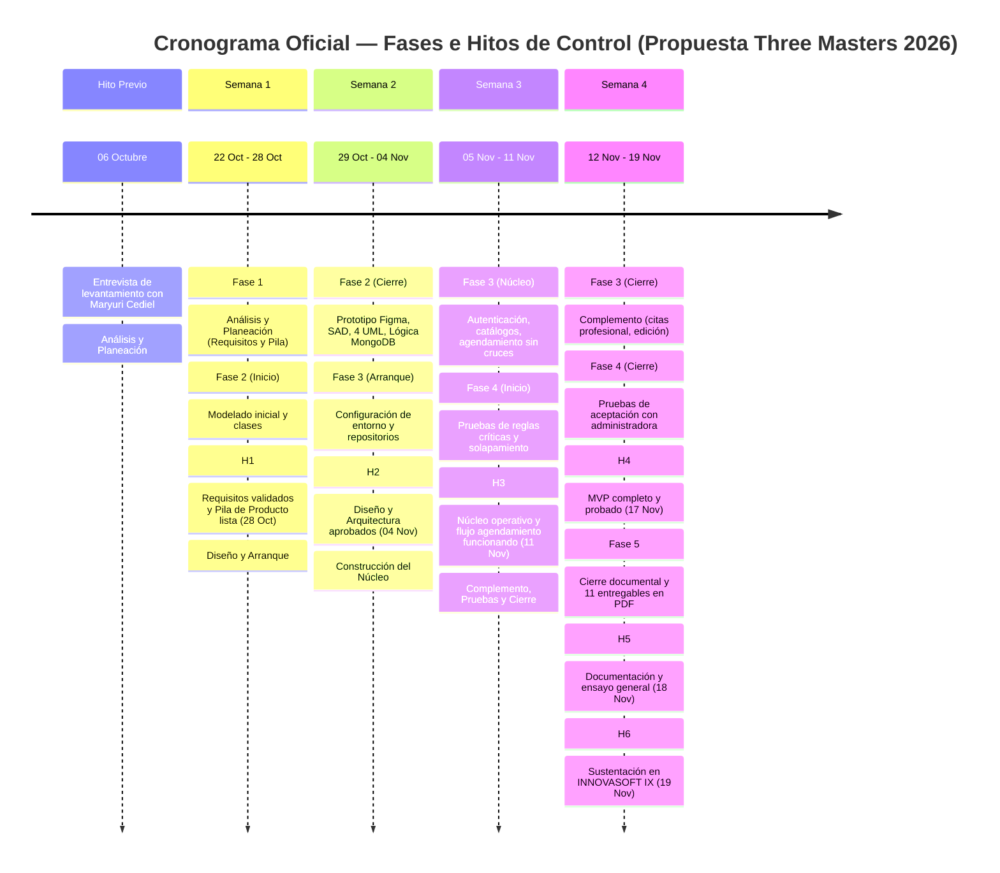
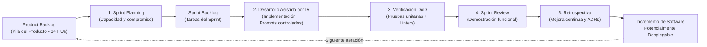

# Documento del Proceso de Desarrollo de Software
**Proyecto:** Sistema de Gestión de Citas Web Three Masters Spa  
**Organización Cliente:** Three Masters Spa (Garzón, Huila) — Representada por Maryuri Cediel  
**Equipo de Proyecto:** Santiago Calderón Almario & Carlos Esteban Anacona Gonzalez  
**Asignatura:** Ingeniería de Software Orientada a Objetos (6° Semestre)  
**Institución:** Universidad Surcolombiana (USCO)  
**Evento:** INNOVASOFT IX — Noviembre de 2026  

---

## 1. Introducción y Objetivos

### 1.1. Introducción
En el contexto actual de la transformación digital, las micro y pequeñas empresas del sector de servicios de estética y cuidado personal enfrentan importantes desafíos operativos relacionados con la gestión manual de sus procesos. Tradicionalmente, la administración de agendas, asignación de turnos y control de clientes en salones de belleza y spas de uñas se ha llevado a cabo mediante canales informales de mensajería instantánea (WhatsApp, Facebook), llamadas telefónicas y registros en papel. Esta práctica propicia problemáticas recurrentes tales como la superposición de citas, la falta de trazabilidad en las cancelaciones, el incumplimiento de horarios y la ausencia de métricas consolidadas sobre el desempeño del negocio.

Frente a esta problemática, el presente documento expone de manera formal el proceso de desarrollo de software llevado a cabo para la concepción, diseño e implementación del sistema web **Three Masters Spa**. Dicho sistema fue desarrollado como proyecto integrador para la asignatura de Ingeniería de Software Orientada a Objetos en la Universidad Surcolombiana, teniendo como objetivo principal centralizar el agendamiento público, garantizar la disponibilidad en tiempo real de profesionales sin cruces de horarios y ofrecer una gestión administrativa integral para el salón ubicado en el barrio Rodrigo Lara (Cl. 1 Sur #12-08) en Garzón, Huila.

Desde la perspectiva metodológica, el ciclo de vida del proyecto se fundamentó en un marco ágil **Scrum Adaptado**, estructurado bajo un enfoque iterativo e incremental a lo largo de 4 semanas de ejecución. Esta aproximación permitió articular el desarrollo guiado por el Modelo de Dominio (*Domain Model* y principios POO) con prácticas contemporáneas de aceleración mediante herramientas de Inteligencia Artificial, manteniendo en todo momento la rigurosidad en la verificación, el control de versiones y la toma de decisiones arquitectónicas mediante registros formales (*Architecture Decision Records* - ADR).

---

### 1.2. Objetivos del Proyecto

#### Objetivo General
Desarrollar una aplicación web orientada a objetos que centralice el agendamiento de citas del servicio de uñas de Three Masters Spa, optimizando la asignación de turnos sin solapamientos de horario y proporcionando a los clientes un mecanismo de reserva en línea ágil, seguro y sin fricción.

#### Objetivos Específicos
* **OE1. Centralizar el agendamiento de citas en un solo medio digital:** Construir un catálogo público por categorías y un flujo de reserva en línea donde la clienta elija profesional y horario disponible, registrándose con datos básicos de contacto y gestionando su cita mediante un enlace único con token criptográfico seguro, sin exigir la creación previa de una cuenta.
* **OE2. Evitar los cruces de horario y las citas sin registrar:** Implementar algoritmos determinísticos de disponibilidad y validación de solapamiento en la entidad de dominio `Cita`, garantizando que el sistema rechace cualquier colisión de horarios para una misma manicurista, incluso bajo escenarios de concurrencia.
* **OE3. Proporcionar a la administración control y visibilidad integral:** Proveer al administrador un panel centralizado para visualizar la agenda completa, gestionar estados de citas (confirmada, completada, cancelada, no asistió), reprogramar turnos y consultar analíticas operativas con filtros temporales.
* **OE4. Facilitar la administración de servicios, tarifas y personal:** Habilitar interfaces administrativas para el mantenimiento autónomo del catálogo (nombres, precios, duraciones, fotos) y de las profesionales (especialidades, cuentas de acceso y franjas de disponibilidad laboral).
* **OE5. Proteger la información mediante control de acceso por roles (RBAC):** Restringir las operaciones y vistas del sistema según el rol autenticado (Administrador, Profesional y Cliente), asegurando que cada profesional únicamente consulte y gestione las citas asignadas a su propia agenda.

---

## 2. Enfoque Metodológico Adoptado

Para dar respuesta a los requerimientos del negocio y a las exigencias académicas de la asignatura, se adoptó un marco de trabajo **Scrum Adaptado (Iterativo e Incremental)**, ajustado a la dinámica de un equipo técnico de dos ingenieros en formación.

### 2.1. Justificación de la Elección
1. **Iteraciones cortas y entregas continuas:** Permitió dividir el alcance en ciclos semanales con hitos de control estrictos (H1 a H6), asegurando incrementos de software funcionales desde la tercera semana.
2. **Priorización por dolor del negocio:** Se concentró el esfuerzo inicial en resolver la necesidad más crítica de Maryuri Cediel (el cruce de horarios y el olvido de citas) antes de construir módulos secundarios.
3. **Adaptabilidad ante refinamientos de diseño:** Facilitó incorporar requerimientos emergentes (como la protección de citas históricas ante la baja definitiva de una profesional) sin alterar la arquitectura base.

### 2.2. Alternativas Metodológicas Descartadas
* **Modelo en Cascada (Waterfall clásico):** Descartado debido a la rigidez de sus fases lineales. En un proyecto donde los criterios de cancelación y las reglas de disponibilidad requerían validación iterativa con la administradora, congelar especificaciones al inicio habría generado riesgos de desfase con el negocio.
* **Proceso Unificado Racional (RUP formal):** Descartado por su excesiva carga burocrática y alta demanda de artefactos documentales pesados, inviables para un equipo de dos desarrolladores en un plazo de cuatro semanas.
* **Scrum Puro Corporativo:** Descartado en su concepción dogmática con roles exclusivos a tiempo completo (Scrum Master y Product Owner dedicados sin programar). En su lugar, los roles fueron distribuidos de forma compartida entre los dos integrantes.

---

## 3. Esquema Gráfico del Proceso de Desarrollo

El ciclo de desarrollo se planificó y ejecutó a lo largo de **cuatro semanas de trabajo formal** (del 22 de octubre al 19 de noviembre de 2026), partiendo del hito previo de la entrevista de levantamiento realizada el 6 de octubre. El proceso articuló **5 fases metodológicas**, controladas por **6 hitos formales de verificación (H1 a H6)** y sincronizadas con el evento de cierre **INNOVASOFT IX**.

### 3.1. Línea de Tiempo Oficial del Proyecto (Fases e Hitos)

---

### 3.2. Ciclo del Sprint Ágil
Durante la construcción del software (Semanas 2 a 4), el trabajo se estructuró a través del ciclo iterativo de Scrum adaptado:

---

## 4. Fases del Proceso de Desarrollo

De acuerdo con el Plan de Trabajo presentado en la Propuesta de Servicios, el desarrollo se descompuso en **cinco fases formales**:

| Fase Oficial | Período / Semanas | Propósito Oficial (Propuesta) | Entradas (Insumos) | Entregables Producidos | Hito Asociado |
| :--- | :--- | :--- | :--- | :--- | :---: |
| **1. Análisis y Planeación** | Semana 1 (22 a 28 Oct) | Cerrar y validar requisitos con el negocio, resolver decisiones pendientes y organizar el trabajo del equipo. | • Entrevista del 6 de octubre. • Cuadernos y chats observados. | • Documento de Propuesta. • Documento de Requerimientos (v1.0). • Historias de Usuario (HU-01 a HU-34). • Pila del Producto (Product Backlog). | **H1** (28 Oct) |
| **2. Diseño** | Semanas 1 a 2 (22 Oct a 04 Nov) | Construir el prototipo visual, la arquitectura de software, los diagramas de ingeniería y el modelo de datos. | • Requerimientos funcionales (52 RFs). • Reglas de negocio (22 RNs). • Pila del producto priorizada. | • Prototipo navegable en Figma. • Documento de Arquitectura (SAD). • 4 Diagramas UML (Clases, Secuencia, Componentes, Actividades). • Lógica de datos de MongoDB. | **H2** (04 Nov) |
| **3. Construcción** | Semanas 2 a 4 (29 Oct a 17 Nov) | Desarrollo e integración del software: Interfaz en React, API REST en Node/Express y Base de Datos en MongoDB. | • Wireframes de Figma. • Especificación de endpoints en SAD. • Lista de Tareas (120 tareas). | • Código fuente en repositorio GitHub. • Núcleo funcional (Sprint 1). • Módulos complementarios (Sprint 2). • Despliegue preliminar. | **H3** (11 Nov) **H4** (17 Nov) |
| **4. Pruebas y Ajustes** | Semanas 3 a 4 (05 a 17 Nov) | Verificar de forma automatizada las reglas críticas del dominio, corregir fallos y validar con la administradora. | • Incrementos de software. • Reglas de no solapamiento (`seSolapaCon`). • Permisos y roles RBAC. | • Suite de 14 pruebas unitarias (`node --test`). • Análisis estático con `oxlint`. • Matriz de resultados de pruebas. | **H4** (17 Nov) |
| **5. Cierre y Exposición** | Semana 4 (12 a 19 Nov) | Consolidación de los 11 entregables exigidos, verificación de rúbrica INNOVASOFT IX y ensayo de sustentación. | • Entregables preliminares. • Plantillas oficiales del docente. • Código congelado (*Code Freeze*). | • Los 11 entregables en formato PDF. • Presentación y diapositivas. • Sustentación presencial del proyecto. | **H5** (18 Nov) **H6** (19 Nov) |

---

## 5. Actividades y Plan Semanal Detallado

Las actividades de ingeniería se ejecutaron secuencialmente cumpliendo los compromisos semanales pactados:

### Semana 1: Análisis y Planeación (22 a 28 de octubre)
* **Actividades ejecutadas:**
  1. Formalización del documento de Propuesta de Servicios y Documento de Requerimientos (v1.0).
  2. Resolución de decisiones iniciales: delimitación del alcance exclusivamente a manicure/pedicure (excluyendo barbería) y confirmación de agendamiento sin cobro de anticipos.
  3. Reunión de validación de entendimiento con Maryuri Cediel `[VALIDAR: Fecha exacta de la reunión / Pendiente en propuesta]`.
  4. Definición del marco metodológico, roles, repositorio GitHub y acuerdos de trabajo.
  5. Redacción de las 34 Historias de Usuario bajo criterios INVEST y estructuración de la Pila del Producto (Product Backlog).
  6. Modelado conceptual del diagrama de clases de dominio.
* **Hito alcanzado:** **H1 (Miércoles 28 de octubre) — Requisitos validados.**

### Semana 2: Diseño y Arranque Técnico (29 de octubre a 4 de noviembre)
* **Actividades ejecutadas:**
  1. Elaboración del prototipo de alta fidelidad en Figma para las 13 pantallas del sistema (flujo cliente C-01 a C-05, admin A-01 a A-05, profesional P-01 a P-03).
  2. Redacción del Documento de Arquitectura de Software (SAD) y construcción de los 4 diagramas UML (Clases, Secuencia, Componentes, Actividades).
  3. Elaboración del documento de Lógica de Datos en MongoDB (patrón de snapshots históricos e indexación).
  4. Desglose de la Lista de Tareas técnicas para el desarrollo.
  5. Configuración de la estructura base del proyecto (Backend modular Node/Express y Frontend React/Vite) y conexión con MongoDB Atlas.
  6. Revisión y validación del prototipo visual con la administradora `[VALIDAR: Fecha exacta de la revisión / Pendiente en propuesta]`.
* **Hito alcanzado:** **H2 (Miércoles 4 de noviembre) — Diseño aprobado.**

### Semana 3: Construcción del Núcleo Operativo (5 a 11 de noviembre)
* **Actividades ejecutadas:**
  1. Infraestructura de autenticación JWT, hash de contraseñas con `bcryptjs` y middlewares de autorización por rol (`RolUsuario`).
  2. Módulo de profesionales y configuración de franjas horarias semanales.
  3. Carga inicial del catálogo de servicios y categorías del salón.
  4. Algoritmo de cálculo de slots de disponibilidad y reserva pública sin cuenta, con prevención estricta de cruces (`seSolapaCon`).
  5. Generación de enlaces seguros con token hash SHA-256 (`tokenHash`) y flujo de cancelación pública.
  6. Panel administrativo de citas: visualización consolidada y transición de estados (completada, cancelada, no asistió).
* **Hito alcanzado:** **H3 (Miércoles 11 de noviembre) — Inicio funcionando (Núcleo MVP operativo).**

### Semana 4: Complemento, Pruebas y Cierre (12 a 19 de noviembre)
* **Actividades ejecutadas:**
  1. Construcción de funcionalidades complementarias: vista de citas asignadas a la profesional con justificación obligatoria de cancelación.
  2. Implementación de guardas avanzadas de negocio (ADR-03: baja definitiva de profesionales y avisos directos por WhatsApp).
  3. Módulo analítico interactivo en el dashboard del Administrador (`ResumenAdminPage.jsx`) con filtros por Semana, Mes y Año.
  4. Ejecución de la suite de 14 pruebas unitarias de dominio con `node --test` y validación estática con `oxlint`.
  5. Prueba de aceptación y demostración final del sistema con Maryuri Cediel `[VALIDAR: Fecha de demostración / Pendiente en propuesta]`.
  6. Congelamiento estricto de código (*Code Freeze* el 17 de noviembre) para garantizar estabilidad.
  7. Consolidación y exportación de los 11 entregables en formato PDF de acuerdo con la rúbrica de INNOVASOFT IX.
* **Hitos alcanzados:**
  - **H4 (Martes 17 de noviembre):** MVP completo y probado.
  - **H5 (Miércoles 18 de noviembre):** Documentación finalizada y ensayo general.
  - **H6 (Jueves 19 de noviembre):** Sustentación presencial en INNOVASOFT IX.

---

## 6. Roles Oficiales del Proyecto

En concordancia exacta con la Sección 9 ("Personal y recursos") de la Propuesta de Servicios, el equipo estuvo integrado por dos estudiantes de 6° Semestre de Ingeniería de Software de la Universidad Surcolombiana:

| Integrante | Rol Oficial en la Propuesta | Rol Metodológico Scrum | Responsabilidades Principales y Entregables Asociados |
| :--- | :--- | :--- | :--- |
| **Santiago Calderón Almario** | • Líder de Proyecto. • Líder de análisis de negocio y requisitos. • Diseño de interfaz y prototipo. • Desarrollo full-stack (interfaz y servidor). | **Product Owner / Fullstack Developer** | • Interlocutor principal con Maryuri Cediel. • Conducción de entrevistas y especificación de requerimientos funcionales. • Diseño de wireframes y prototipo en Figma. • Programación de componentes frontend y endpoints del núcleo. • *Entregables a cargo:* Propuesta, Requerimientos, HUs, Pila del Producto, Prototipo Figma, Proceso de desarrollo y Lista de tareas. |
| **Carlos Esteban Anacona Gonzalez** | • Arquitectura y datos. • Calidad y pruebas. • Documentación y uso de IA. • Desarrollo full-stack (interfaz y servidor). | **Scrum Master / QA / Software Architect** | • Definición de la arquitectura técnica (Monolito Modular POO) y diseño de datos en MongoDB. • Elaboración de los 4 diagramas UML y documento SAD. • Construcción de la suite de 14 pruebas unitarias dinámicas. • Gestión del registro técnico de asistencia con Inteligencia Artificial. • *Entregables a cargo:* SAD, Diagramas UML, Lógica de Datos MongoDB, Apartado de IA y Pruebas. |
| **Maryuri Cediel** | Dueña y Administradora de Three Masters | **Cliente / Stakeholder Principal** | • Fuente primaria del levantamiento de información. • Validación del entendimiento, tarifas y duraciones de servicios. • Aprobación de demostraciones y recepción de entregables. |

---

## 7. Eventos y Artefactos Scrum

El equipo adaptó las ceremonias y artefactos ágiles para optimizar el tiempo disponible sin perder rigor metodológico:

### 7.1. Eventos Ágiles
* **Sprint Planning (Planificación):** Sesiones de 2 horas al inicio de cada ciclo de desarrollo para estimar capacidad (40 puntos por sprint para el equipo), evaluar la Pila del Producto y comprometer las historias que cumplieran la *Definition of Ready* (38 puntos en Sprint 1; 34 puntos en Sprint 2).
* **Daily Scrum (Sincronización Diaria):** Encuentros ágiles de 10 minutos para revisar el progreso diario, prioridades y registrar impedimentos técnicos en la bitácora de ADRs.
* **Sprint Review (Revisión del Incremento):** Demostración en vivo al cierre de cada ciclo funcional frente a los criterios de aceptación de las Historias de Usuario.
* **Sprint Retrospective (Retrospectiva):** Espacio de mejora continua tras la revisión, del cual surgieron compromisos formales como el congelamiento de código (*Code Freeze*) para evitar el desborde del alcance (*scope creep*).

### 7.2. Acuerdos de Calidad (DoR y DoD)
* **Definition of Ready (DoR):** Una historia solo ingresó al sprint si contaba con ID único, rol, acción, beneficio, mínimo dos criterios de aceptación verificables, identificación de módulos a intervenir y ausencia de bloqueos de negocio.
* **Definition of Done (DoD):** Una tarea se declaró terminada (*Done*) únicamente si el código fue integrado en `main`, contó con pruebas unitarias automáticas (`node --test`), pasó la verificación de linters (`oxlint`), respetó el control de acceso por roles y quedó documentada con su evidencia de ruta en el repositorio.

---

## 8. Buenas Prácticas de Ingeniería de Software Evidenciadas

1. **Control de Versiones Semántico:** Uso de ramas de funcionalidad (*feature branches*) integradas a `main` y mensajes de commit estandarizados con prefijos (`feat:`, `fix:`, `refactor:`, `test:`, `docs:`), vinculados a las tareas de la Pila.
2. **Trazabilidad Integral y Registros ADR:** Mapeo bidireccional entre Historias de Usuario (HU-01 a HU-34), código fuente y pruebas. Formalización de Decisiones Arquitectónicas (ADRs en `AGENTS.md`):
   - *ADR-01:* Notificaciones al cliente asistidas exclusivamente por enlaces `wa.me`, descartando proveedores SMTP/SMS de pago.
   - *ADR-02:* Suite de pruebas unitarias dinámicas con runner nativo de Node.js (`node --test`), eliminando dependencias pesadas.
   - *ADR-03:* Baja definitiva de profesionales con guardas de integridad (cancelación con motivo obligatorio y preservación del nombre histórico de la profesional en la cita).
   - *ADR-04:* Reemplazo de exportaciones a PDF/Excel por un módulo analítico interactivo integrado en el dashboard.
   - *ADR-05:* Tratamiento preventivo de citas afectadas ante cambios en franjas horarias `[PENDIENTE: Formalizar registro documental]`.
3. **Verificación y Pruebas Dinámicas:** Implementación de 14 suites de pruebas unitarias (`test/` y `tests/`) que validan la lógica de negocio pura de las entidades de dominio (`Cita.seSolapaCon`, aritmética de `Hora`, normalización de `Fecha` UTC y guardas en `ProfesionalServicio`).
4. **Seguridad y Configuración:** Almacenamiento seguro de contraseñas con `bcryptjs` (10 rondas de salt), hashing de enlaces públicos con SHA-256 (`tokenHash`) con restricción `{ select: false }` y gestión de credenciales en variables de entorno `.env` documentadas en `.env.example`.

---

## 9. Gestión de Cambios y Riesgos

### 9.1. Cambios Relevantes durante el Desarrollo
* **Prevención de duplicados en Catálogo:** Durante el Sprint 1 se detectó que categorías o servicios repetidos con diferencias de acentos o mayúsculas generaban inconsistencias. Se añadieron validaciones normalizadas insensibles a mayúsculas y tildes (`S1-T11`, `S1-T15`).
* **Protección del historial por baja de personal:** Se introdujo el *Snapshot Pattern* en la cita (`profesional.nombre`) y guardas estrictas de cancelación justificada para evitar que las citas pasadas quedaran huérfanas al retirar una manicurista del sistema (ADR-03).
* **Aviso de citas por modificación de horarios:** Se implementó el componente `AvisoCitasAfectadas.jsx` para listar detalladamente las citas afectadas antes de confirmar el borrado de una franja de disponibilidad laboral.

### 9.2. Matriz de Riesgos Identificados y Mitigados

| Riesgo Técnico / Operativo | Severidad | Probabilidad | Estrategia de Mitigación Implementada | Estado |
| :--- | :---: | :---: | :--- | :---: |
| **Doble reserva o cruces de citas simultáneas** | Alta | Alta | Algoritmo determinístico `seSolapaCon` en entidad `Cita` respaldado por índice compuesto `{ idProfesional, fecha, horaInicio }` en MongoDB. | Mitigado y Probado |
| **Desfase de horarios por zona horaria** | Alta | Media | Fechas normalizadas estrictamente a medianoche UTC (`00:00:00.000Z`) y horas almacenadas en texto formato `"HH:mm"`. | Mitigado y Probado |
| **Secuestro de enlaces de citas públicas** | Alta | Baja | Generación de token criptográfico aleatorio de 32 bytes; la base de datos solo almacena el hash SHA-256 irreversible. | Mitigado y Probado |
| **Crecimiento descontrolado del alcance (*Scope Creep*)** | Alta | Alta | Regla estricta de *Code Freeze* a partir del 17 de noviembre: congelamiento de funciones para priorizar pruebas y sustentación. | Mitigado |
| **Reclamación de historial por teléfono sin SMS/OTP** | Media | Media | Se vincula por teléfono y nombre normalizados en el primer login. `[VALIDAR: Asumido como limitación conocida para esta entrega; validación por SMS queda como trabajo futuro]`. | Aceptado como Limitación |
| **Sincronización de estado FN-16 y FN-17 en documentos** | Baja | Baja | Reconciliar la discrepancia entre las analíticas operativas de `ResumenAdminPage.jsx` y el estado documental. | `[PENDIENTE: Actualizar funcionalidades.md]` |

---

## 10. Planeado frente a Ejecutado

A lo largo del proyecto se mantuvo un seguimiento riguroso entre la línea base establecida en la Propuesta y los resultados efectivamente alcanzados al cierre de la Semana 4:

| Hito / Entregable | Fecha Planeada | Fecha Ejecutada | Desviación y Justificación Técnica |
| :--- | :--- | :--- | :--- |
| **H1: Requisitos validados** | Miércoles 28 Oct | Miércoles 28 Oct | Cumplido a tiempo. Entrevista analizada y 34 HUs priorizadas. |
| **H2: Diseño aprobado** | Miércoles 04 Nov | Miércoles 04 Nov | Cumplido a tiempo. Prototipo Figma, SAD, 4 UML y Lógica de datos finalizados. |
| **H3: Núcleo funcionando** | Miércoles 11 Nov | Miércoles 11 Nov | Cumplido a tiempo. Flujo público completo de agendamiento y panel administrativo básico. |
| **H4: MVP completo y probado** | Martes 17 Nov | Martes 17 Nov | Cumplido. Funcionalidades de prioridad alta y media terminadas; inicio de *Code Freeze*. |
| **H5: Documentación y ensayo** | Miércoles 18 Nov | Miércoles 18 Nov | Cumplido. Generación de los 11 entregables en formato PDF para plataforma INNOVASOFT. |
| **H6: Exposición INNOVASOFT IX** | Jueves 19 Nov | Jueves 19 Nov | Sustentación final del proyecto ante evaluadores académicos. |

### Balance de Alcance y Desviaciones Justificadas
* **Puntos de historia y velocidad:** Se planificaron y ejecutaron satisfactoriamente **72 puntos de historia** distribuidos en dos sprints (38 puntos en Sprint 1 y 34 puntos en Sprint 2), completando las 34 Historias de Usuario comprometidas.
* **Ajuste de canal de notificaciones (ADR-01):** La propuesta contemplaba evaluar recordatorios automáticos. Se adoptó la estrategia asistida por enlaces directos `wa.me` para evitar los costos comerciales y tiempos de verificación de la API de WhatsApp Business.
* **Ajuste de reportes contables (ADR-04):** Se descartó la generación de reportes exportables a PDF/Excel, sustituyéndolos por un módulo analítico interactivo con filtros dinámicos (Semana, Mes, Año) en el dashboard del Administrador, respondiendo mejor al uso móvil y operativo del salón.

---

## 11. Herramientas y Tecnologías Utilizadas

| Categoría | Herramienta / Tecnología | Propósito en el Proyecto |
| :--- | :--- | :--- |
| **Entorno y Lenguaje** | Node.js (v20+ ES Modules) | Entorno de ejecución en servidor para la API REST. |
| **Backend Framework** | Express 5.3 | Enrutamiento modular, middlewares de seguridad y controladores HTTP. |
| **Base de Datos y ODM** | MongoDB Atlas & Mongoose 9 | Base de datos NoSQL documental y mapeo con clases del Modelo de Dominio. |
| **Frontend Framework** | React 19 & Vite 8 | Construcción de interfaz de usuario reactiva, modular y SPA con React Router v7. |
| **Estilos y Maquetación** | CSS Modules | Encapsulamiento de estilos y variables CSS temáticas (paleta vino/rosa palo). |
| **Control de Versiones** | Git & GitHub | Repositorio colaborativo, control de ramas y trazabilidad de commits. |
| **Diseño y Prototipado** | Figma | Diseño visual de interfaz (UI/UX) y prototipo interactivo para las 13 pantallas. |
| **Modelado UML** | Mermaid / PlantUML | Generación de diagramas de Clases, Secuencia, Componentes y Actividades. |
| **Almacenamiento Multimedia** | Cloudinary & Multer | Almacenamiento persistente en la nube de fotos de servicios y manicuristas. |
| **Pruebas y Calidad** | `node --test` & `oxlint` | Suite de 14 pruebas unitarias dinámicas nativas y análisis estático de código. |
| **Asistencia con IA** | Antigravity / Claude | Asistente técnico de programación para generación de pruebas y aceleración de código. |

---

## Anexos

* **Anexo A — Catálogo Resumido de la Pila del Producto:** Tabla resumen con las 34 Historias de Usuario (HU-01 a HU-34), rol, puntos y sprint de ejecución *(ver detalle completo con criterios de aceptación en el Entregable 05)*.
* **Anexo B — Dossier Gráfico de Diagramas UML:** Especificación visual de los diagramas de Clases, Secuencias, Componentes y Actividades *(ver detalle técnico en los Entregables 08 y 09)*.
* **Anexo C — Gráfica de Quemado (*Burndown Chart*):** Curva de avance de puntos planeados vs. ejecutados durante los Sprints 1 y 2.
