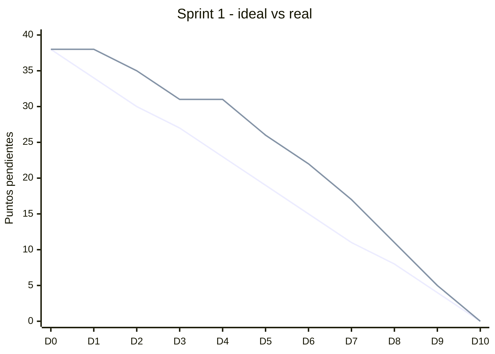
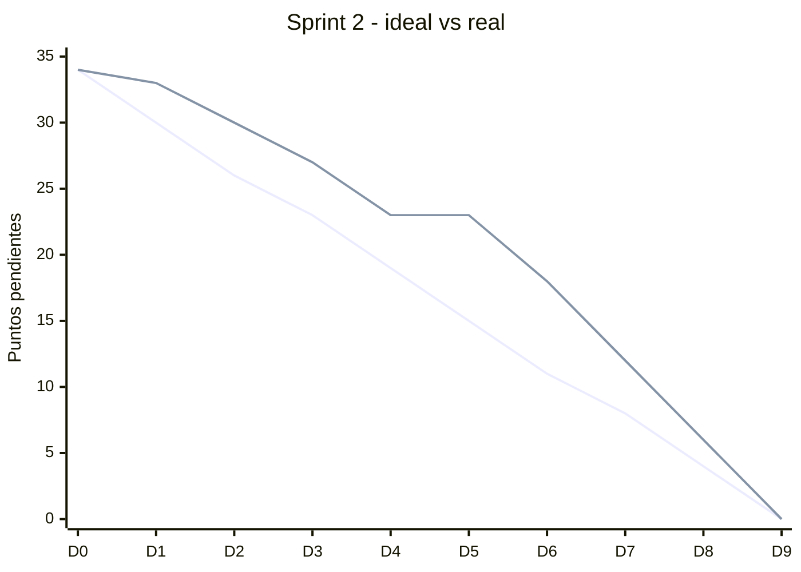

# 05 · Burndown

Datos exportables en [`05-burndown.csv`](05-burndown.csv). `ideal` es la línea recta entre los puntos comprometidos y cero; `real` es el trabajo efectivamente cerrado al final de cada día.

## Sprint 1 · 38 puntos · 10 días

| Día | Fecha | Ideal | Real | Diferencia | Observación |
|---|---|---:|---:|---:|---|
| D0 | 23 oct | 38 | 38 | 0 | Inicio del sprint |
| D1 | 26 oct | 34 | 38 | +4 | Configuración del entorno, sin avance en puntos |
| D2 | 27 oct | 30 | 35 | +5 | Login y rutas protegidas |
| D3 | 28 oct | 27 | 31 | +4 | Categorías y servicios |
| D4 | 29 oct | 23 | 31 | +8 | Espera de decisión de alcance |
| D5 | 30 oct | 19 | 26 | +7 | Alta de servicios y profesionales |
| D6 | 2 nov | 15 | 22 | +7 | Especialidades y horarios |
| D7 | 3 nov | 11 | 17 | +6 | Catálogo y disponibilidad |
| D8 | 4 nov | 8 | 11 | +3 | Reserva pública y panel |
| D9 | 5 nov | 4 | 5 | +1 | Enlace y estados de cita |
| D10 | 6 nov | 0 | 0 | 0 | Cierre del núcleo |

**Lectura:** la curva real va por encima de la ideal durante casi todo el sprint y se recupera al final. No es una falla: el día 1 se perdió configurando el entorno y el día 4 se detuvo el trabajo a la espera de una decisión de alcance. El equipo no sacó historias del sprint para "arreglar" la gráfica; absorbó el retraso trabajando los días 8 a 10. Esa es la explicación que conviene dar en la sustentación.

## Sprint 2 · 34 puntos · 9 días

| Día | Fecha | Ideal | Real | Diferencia | Observación |
|---|---|---:|---:|---:|---|
| D0 | 6 nov | 34 | 34 | 0 | Inicio del sprint |
| D1 | 9 nov | 30 | 33 | +3 | Edición de servicio y listado de categorías |
| D2 | 10 nov | 26 | 30 | +4 | Sin funciones nuevas desde hoy |
| D3 | 11 nov | 23 | 27 | +4 | Baja de franjas y registro de cliente |
| D4 | 12 nov | 19 | 23 | +4 | Baja definitiva y cuentas vinculadas |
| D5 | 13 nov | 15 | 23 | +8 | Decisión de citas afectadas, sin avance |
| D6 | 16 nov | 11 | 18 | +7 | Paneles de profesional y cliente |
| D7 | 17 nov | 8 | 12 | +4 | Cancelación justificada y WhatsApp |
| D8 | 18 nov | 4 | 6 | +2 | Reprogramación y regresión |
| D9 | 19 nov | 0 | 0 | 0 | Cierre y exposición |

**Lectura:** el sprint arranca con un punto menos de avance por la transición desde el cierre del Sprint 1. El día 5 vuelve a aparecer una línea plana: se tomó la decisión de **solo advertir** las citas afectadas por cambiar o eliminar una franja, sin cancelarlas ni reprogramarlas. El último tramo es más pronunciado porque desde el 10 de noviembre no se agregó alcance nuevo y el equipo se dedicó a cerrar, probar y documentar.

## Resumen

| Sprint | Comprometido | Entregado | Días | Velocity | Puntos/día |
|---|---:|---:|---:|---:|---:|
| 1 | 38 | 38 | 10 | 38 | 3,8 |
| 2 | 34 | 34 | 9 | 34 | 3,8 |
| **Total** | **72** | **72** | **19** | **promedio 36** | **3,8** |

La velocidad por día es constante (3,8). La caída de 38 a 34 puntos se debe a que el Sprint 2 tuvo **un día menos**, no a una caída de productividad. Es una observación mejor para la retro que la de "bajó el rendimiento".
